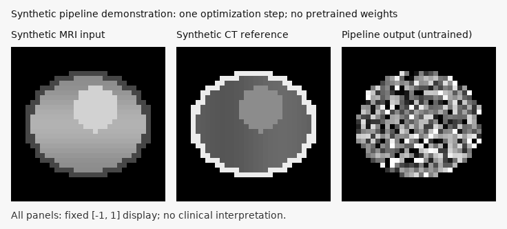

# Swin-PFGM: 2.5D MRI-to-CT synthesis

A research implementation of conditional MRI-to-CT image synthesis using a **3D SwinFIR-style U-Net, PFGM++ perturbations, and EDM preconditioning and sampling**. Four adjacent slices are processed together to provide local through-plane context while combining attention with spatial-frequency features.

Implementation by [Lloydkamole](https://github.com/Lloydkamole). The implementation is the author's work; the underlying published methods and datasets are credited in [ATTRIBUTION.md](ATTRIBUTION.md). This is an exploratory research project, with no demonstrated clinical suitability.


*Logged validation comparison from epoch 166 of `20260627_104352_pfgm_fir_25d`, selected by the highest recorded validation-sample PSNR. Rows: MRI, predicted CT, reference CT. Synthesized CT backgrounds are blacked out using the actual body masks, recovered by exact MRI/reference-CT pixel matching. Foreground pixels retain TensorBoard's original independent scaling, so this preview does not use a shared HU window. The three matched cases are from SynthRAD2023; patient identifiers are not included. Dataset attribution and noncommercial terms apply. See [results and provenance](docs/results.md).*

## What the code implements

- A conditional U-Net operating on `[B, 1, D, H, W]` patches, with 3D convolutions and 3D spatial-frequency blocks using FFTs.
- Radius/noise conditioning, window attention or 3D deformable attention, and optional body-mask attention bias.
- PFGM++ inverse-beta perturbations and prior initialization, together with EDM preconditioning and a stochastic Heun sampler.
- MRI conditioning dropout, classifier-free guidance, optional guidance rescaling, and dynamic guidance scheduling. The option named `use_cfg_plus_plus` performs standard-deviation rescaling of guided predictions; it is not established as a faithful implementation of the published CFG++ algorithm.
- Training-time EMA, gradient checkpointing, optional spatial flip augmentation at sampling time, Accelerate integration, and TensorBoard logging.

```text
Aligned, normalized MRI + CT (+ body mask)
          │
          ├── loader: consecutive 4-slice patches
          │
Noisy CT + MRI ──> radius-conditioned 3D U-Net ──> EDM denoised CT estimate
                                                      │
MRI + sampled prior ──> iterative Heun sampling ───────┘
```

The public repository focuses on `train_accelerate_25d.py`. Historical trainers, notebooks, slides, private analysis, datasets, checkpoints, and generated runs remain on the author's workstation and are ignored by Git.

## Installation

Use Python 3.10 or 3.11 for a new environment. Install a matching PyTorch/torchvision pair first; the commands below follow the [official PyTorch 2.8 installation matrix](https://pytorch.org/get-started/previous-versions/#v2-8-0).

```bash
git clone https://github.com/Lloydkamole/Swin_pfgm.git
cd Swin_pfgm
python3.11 -m venv .venv
source .venv/bin/activate
python -m pip install --upgrade pip

# CPU quick start:
python -m pip install torch==2.8.0 torchvision==0.23.0 \
  --index-url https://download.pytorch.org/whl/cpu
python -m pip install -r requirements.txt
```

For a CUDA-enabled GPU environment, replace the CPU installation command with a build compatible with your driver, for example:

```bash
python -m pip install torch==2.8.0 torchvision==0.23.0 \
  --index-url https://download.pytorch.org/whl/cu128
python -c 'import torch; print(torch.cuda.is_available())'
```

A fresh installation has not been tested here. The CPU checks used the existing Python 3.9 environment with PyTorch 2.8.0, Accelerate 1.10.1, MONAI 1.5.1 and TorchMetrics 1.4.0.post0. That environment has an older torchvision build which emits an image-extension warning; the commands above use the officially matched pair. See [validation](docs/validation.md) for exact versions and limits. FlashAttention, MedSAM weights and pretrained models are not required for this 2.5D pipeline.

## Quick start: synthetic pipeline check

```bash
python -m examples.synthetic_demo
```

This creates four analytic phantom MRI/CT pairs, loads them through the actual NIfTI loader, computes the PFGM++ loss, checks a backward pass, performs one optimizer update, and runs a two-step sampler on CPU. It needs no downloaded dataset or trained weights.

Outputs go to the ignored `examples/generated/` directory: NIfTI phantoms, a small checkpoint, resolved configuration, a report, and `comparison.png`.



*Pipeline demonstration only: the third panel comes from a model after one synthetic optimization step and does not demonstrate learned MRI-to-CT synthesis. All panels use the same fixed `[-1, 1]` grayscale window.*

See [example instructions](examples/README.md) for a complete one-epoch training check and checkpoint inference.

## Data preparation

Provide one folder per paired patient, with aligned 3D NIfTI MRI/CT volumes and an optional binary body mask:

```text
paired_data/
  patient_001/
    mr.nii.gz
    ct.nii.gz
    mask.nii.gz
  patient_002/
    ...
```

Names are matched by configurable substrings: `mr.nii`, `ct.nii`, and `mask`. The matching also accepts uncompressed `.nii` files. Keep exactly one matching file per modality per folder.

1. Obtain the dataset under its own terms. The author's experiments use SynthRAD2023 and SynthRAD2025 samples; the input pool is a custom prepared subset, not the official challenge evaluation split.
2. Register/align paired modalities and masks before training, and confirm matching voxel grids. The loader orients to RAS and resizes in-plane; it does not perform registration or physical-spacing resampling.
3. Convert MRI and CT intensities to the intended `[-1, 1]` training scale **before loading**. The loader clamps values; it does not normalize raw MRI values or CT Hounsfield units. The historical preprocessing/inverse CT mapping is not included, so HU-level evaluation cannot be reproduced from this repository alone.
4. Use binary masks on the same grid. Missing masks become all-ones masks. Inspect loader warnings: patch-loading failures can return zero tensors in the existing loader.
5. Verify that the stored last volume axis corresponds to the intended slice direction. Patch indices are scanned before orientation. Incomplete edge patches are skipped.

SynthRAD2023 uses NIfTI; SynthRAD2025 is distributed as `.mha` and must be converted to the prepared NIfTI layout. No raw datasets or patient identifiers are shipped. Data references and the SynthRAD2025 Center D restriction are in [ATTRIBUTION.md](ATTRIBUTION.md).

## Training

Run commands from the repository root. Supply the dataset explicitly; no workstation path is embedded in the trainer.

```bash
# Inspect the complete configuration without starting training:
python train_accelerate_25d.py --config configs/train_25d.json --print-config

# Single GPU:
CUDA_VISIBLE_DEVICES=0 python train_accelerate_25d.py \
  --config configs/train_25d.json \
  --data-dir /path/to/paired_data \
  --output-dir outputs_accelerate_25d

# Two GPUs, DDP:
accelerate launch --multi_gpu --num_processes 2 --gpu_ids 0,1 \
  --mixed_precision bf16 train_accelerate_25d.py \
  --config configs/train_25d.json --data-dir /path/to/paired_data
```

`--epochs`, `--batch-size`, and `--num-workers` override the JSON settings. `--cpu` selects CPU execution and disables mixed precision. JSON files can contain partial overrides; unknown keys fail early. `"Infinity"` represents the unbounded `S_max` sampler limit. Model/attention settings live in the JSON files.

| Configuration | Purpose |
|---|---|
| `configs/train_25d.json` | Existing full-model defaults: 4 × 256 × 256 patches, batch 5, 300 epochs, bf16 |
| `configs/smoke_25d.json` | Tiny CPU pipeline check: 4 × 32 × 32 patches, batch 1, one epoch |
| `configs/showcase_25d.json` | Sanitized logged hyperparameters from the highest sample-PSNR run; batch 10, 200 epochs |

The patient list is shuffled with seed 42 and split 90%/10% by patient. New runs save `config.json` and `split.json` alongside logs and checkpoints. `split.json` contains local file paths and patient IDs and stays excluded from Git. Historical runs did not save a split manifest or source revision.

Each run writes `checkpoints/best` selected by validation denoising loss, periodic epoch checkpoints, and `checkpoints/final`. TensorBoard logs include denoising losses, sampled image comparisons and center-slice image metrics:

```bash
tensorboard --logdir outputs_accelerate_25d
```

The trainer contains an FSDP branch, but FSDP has not been verified and no validated FSDP configuration is shipped. The documented multi-GPU command uses DDP. Checkpoint resumption is not implemented; a non-null `resume` now fails explicitly instead of silently starting a fresh run. EMA is used for sampling during training but its shadow weights are not persisted in current checkpoints.

## Patch inference and evaluation

Use a plain `model.safetensors` and a configuration matching its architecture. This command predicts **one small volumetric patch**, not a complete CT volume:

```bash
python inference_25d.py \
  --config /path/to/run/config.json \
  --checkpoint /path/to/run/checkpoints/final/model.safetensors \
  --mr /path/to/patient/mr.nii.gz \
  --ct /path/to/patient/ct.nii.gz \
  --mask /path/to/patient/mask.nii.gz \
  --device cuda --output-dir inference_output_25d
```

When a body mask is available, generated CT voxels outside it are set to **-1** in the model's output scale, which maps to **0 (black)** in `[0, 1]`. This final-output processing also applies to training/validation previews and flip-augmented sampling; foreground values and sampler dynamics are preserved. Without a mask, the output is left unmasked.

`--ct` is optional; provide it for a reference comparison and center-slice PSNR/SSIM/MAE. `--mask` is optional. `--patch-index`, `--steps`, and `--seed` select the patch and sampling settings. CPU execution is available with `--device cpu`. Output includes `prediction.safetensors` with shape `[1, 1, D, H, W]`, `comparison.png` with a fixed `[-1, 1]` display, and `metrics.json`. Weights load strictly; sharded FSDP checkpoints and automatic EMA restoration are unsupported.

Metrics clamp the predicted center slice to `[-1, 1]`, map images to `[0, 1]`, and use data range 1. With a mask, PSNR/SSIM are computed on images whose background is zeroed; background pixels remain in their calculation. MAE is averaged within the mask. These scores are normalized-intensity metrics, not HU errors, and are not interchangeable with official SynthRAD challenge metrics. There is no complete-volume or held-out test-set evaluation script in this public scope.

## Recorded experimental results

Fifteen local 2.5D runs were inspected; ten contain validation-generation scores. At the highest observed validation-sample PSNR:

| Run | Epoch | PSNR (dB) | SSIM | MAE in [0, 1] |
|---|---:|---:|---:|---:|
| `20260627_104352_pfgm_fir_25d` | 166 | 34.0598 | 0.93635 | 0.01240 |

All three values come from the same logged event. They describe up to three shuffled validation center slices on the main process, not an average over the validation dataset. EMA weights and 40 sampling steps were configured. Exact cohort membership, preprocessing, historical source revision and device model are unrecorded. No checkpoint was saved at epoch 166, and historical EMA weights were not saved, so this image/score cannot be exactly regenerated from the nearby raw checkpoint.

[Detailed results](docs/results.md) include independently best SSIM/MAE/loss events, checkpoint limitations, a comparison chart, and machine-readable summaries. Regenerate the sanitized report from local logs with:

```bash
python -m tools.summarize_runs_25d \
  --runs-dir outputs_accelerate_25d --output-dir docs --plot
```

## Hardware and status

The tiny 0.11M-parameter CPU example and one-epoch training check were run successfully. Full-model GPU training was not verified in this session: the GPU driver was unavailable. The showcase run logs a peak allocated GPU memory of **18,531.5 MiB (about 18.1 GiB)** with bf16, gradient checkpointing and batch size 10. This is a recorded allocation, not a minimum VRAM requirement or total device usage; the GPU model and launch settings were not logged. Reduce batch size if needed and measure on your hardware.

Volume caching holds the full prepared dataset in RAM for each training process. Memory needs depend on volume sizes and process count. bf16 requires hardware support; use `mixed_precision: "no"` when unavailable.

The scientific training/model/metric calculations were preserved during repository cleanup. Remaining limitations include missing historical preprocessing and split manifests, sampled validation reporting, absent public trained weights, missing EMA checkpoint state, incomplete resumption/FSDP support, and patch-only inference. The preview does not establish generalization, superiority to other methods, or clinical usefulness.

## Attribution, license, and repository review

See [ATTRIBUTION.md](ATTRIBUTION.md) for method and dataset references. The preceding README declared MIT, but no project `LICENSE` file was present in accessible history. That declaration is retained as a historical statement, not replaced with a newly assumed license. The author should confirm the project license and add its text before release; dataset images retain their separate terms.

[Repository audit](docs/repository_audit.md) documents the history/privacy review and preserved local files. [Validation](docs/validation.md) lists executed checks and untested paths. Nothing has been pushed or published by this cleanup.
