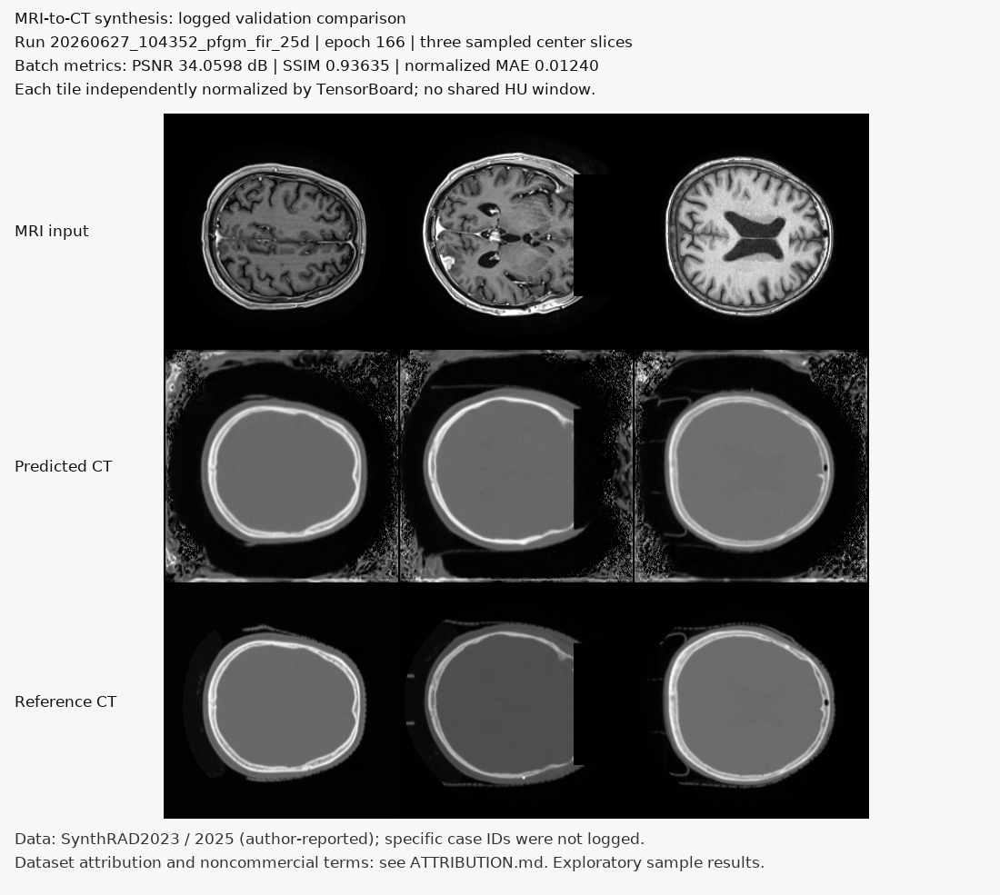
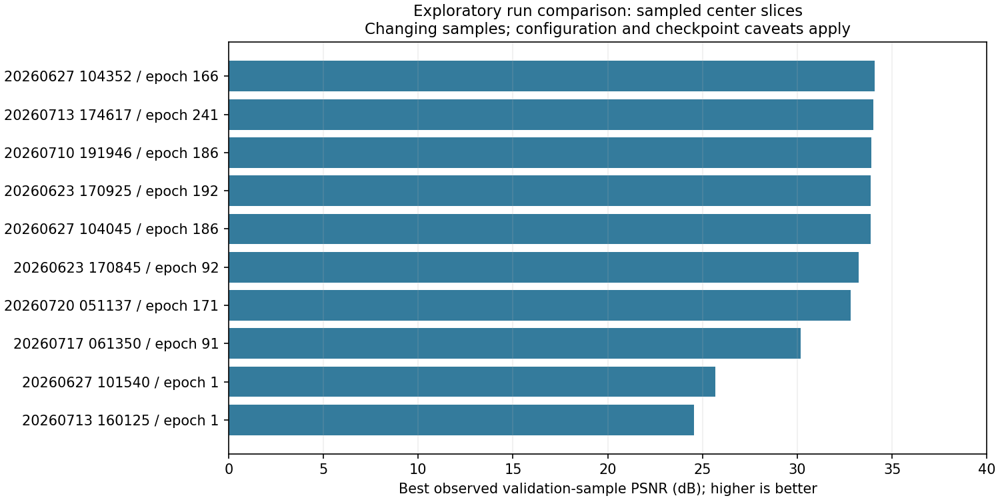

# Recorded 2.5D experiments

This report is extracted from 15 local run directories; 10 contain validation-generation scalar metrics. It reports **sampled validation center slices**, not full-dataset or official challenge results. All values below are real logged values; no missing results were inferred.

## Highest observed sample PSNR

The selected showcase is `20260627_104352_pfgm_fir_25d`, logged step 165 (**epoch 166**, using step + 1). At that same event: PSNR **34.0597687 dB**, SSIM **0.9363517**, normalized MAE **0.01240153**.



The preview uses the original TensorBoard tile scaling (`normalize=True, scale_each=True`), with labels and attribution added. It does not use a shared HU/intensity window. Rows: MRI / prediction / reference; columns: three sampled validation center slices. The author identifies the source as SynthRAD2023/SynthRAD2025 and authorized inclusion. Exact case IDs were not logged. See [asset provenance](showcase_provenance.json) and [dataset attribution](../ATTRIBUTION.md).

## Comparison at each run's best PSNR event

| Run | Epoch | PSNR (dB) | SSIM at same event | MAE at same event | Exact epoch checkpoint |
|---|---:|---:|---:|---:|---|
| `20260627_104352_pfgm_fir_25d` | 166 | 34.0598 | 0.93635 | 0.01240 | no |
| `20260713_174617_pfgm_fir_25d` | 241 | 34.0148 | 0.94038 | 0.01363 | no |
| `20260710_191946_pfgm_fir_25d` | 186 | 33.8853 | 0.94329 | 0.01281 | no |
| `20260623_170925_pfgm_fir_25d` | 192 | 33.8769 | 0.94948 | 0.01443 | no |
| `20260627_104045_pfgm_fir_25d` | 186 | 33.8612 | 0.93024 | 0.01419 | no |
| `20260623_170845_pfgm_fir_25d` | 92 | 33.2434 | 0.94153 | 0.01244 | no |
| `20260720_051137_pfgm_fir_25d` | 171 | 32.7936 | 0.93044 | 0.01493 | no |
| `20260717_061350_pfgm_fir_25d` | 91 | 30.1783 | 0.86542 | 0.01953 | no |
| `20260627_101540_pfgm_fir_25d` | 1 | 25.6566 | 0.82725 | 0.04049 | no |
| `20260713_160125_pfgm_fir_25d` | 1 | 24.5376 | 0.78150 | 0.05037 | no |



Independent selections across all runs:

- Highest SSIM: **0.9494768**, `20260623_170925_pfgm_fir_25d`, epoch **192**.
- Lowest normalized MAE: **0.01156733**, `20260623_170925_pfgm_fir_25d`, epoch **142**.
- Lowest validation denoising loss: **0.006003900**, `20260720_051137_pfgm_fir_25d`, epoch **239**.

These are different selection criteria. Validation denoising loss chooses the trainer's `best` checkpoint; it does not select the highest image-generation PSNR. Independent best metrics must not be combined into a fictional single result. Selecting maxima over changing random samples is optimistic; the ranking is exploratory.

## Dataset, split, configuration and metric scope

The author identifies the data as SynthRAD2023 and SynthRAD2025. The current prepared local pool has 304 matched MRI/CT/mask folders: 163 with SynthRAD2023 Task-1 brain prefixes and 141 with SynthRAD2025 head-and-neck prefixes. This is current filesystem evidence, not proof of the cohort present during each historical run. The historical logged data path points to this custom prepared pool; no saved case membership, preprocessing script or split manifest was found.

The showcase hparams specify a seeded 90%/10% patient split; seed 42; patch depth 4; in-plane size 256; base channels 64; channel multipliers [1,2,3,4]; one residual block per stage; two attention blocks; deformable attention with kv_stride 2 and offset range 4; PFGM++ D=128; batch size 10; 200 epochs; lr=1e-4; bf16; gradient checkpointing; body masks; EMA decay 0.9999; 40 sampler steps; and guidance scheduling from 2 to 1. The sanitized complete configuration is [showcase_25d.json](../configs/showcase_25d.json). It differs from current training defaults.

Generation metrics are computed on up to three center slices from the first shuffled validation batch on the main process, using configured EMA weights. Predicted values are clamped to [-1,1], then mapped with the references to [0,1]. PSNR and SSIM operate on images with zeroed background, including those pixels; MAE is averaged within the mask. Scores are not HU errors, whole-volume averages, held-out test results, or the official challenge evaluation. Exact historical metric code/source revision was not logged, so the definitions describe the current trainer implementation rather than a version-verified historical protocol.

## Checkpoint availability and reproducibility

The PSNR winner logged its image at epoch 166. Its periodic snapshots include epochs 165 and 170, **not 166**. `best` reflects denoising loss. The training EMA helper is not registered for checkpointing; only raw model weights were saved. Therefore the epoch-166 EMA image and scores cannot be exactly recreated from a nearby checkpoint.

The epoch-165 `model.safetensors` header has 409 tensors, all with keys and shapes matching the model instantiated from `configs/showcase_25d.json`. This verifies structural compatibility only, not numerical equivalence or recovery of the epoch-166 EMA output. A full historical checkpoint inference run was not performed.

The showcase run's maximum logged allocated memory is 18,531.5 MiB (~18.1 GiB). Two process RNG files exist in the inspected checkpoint, but GPU model, driver and original launch configuration are not recorded. This is not a hardware minimum.

## Reproducing the report

```bash
python -m tools.summarize_runs_25d \
  --runs-dir outputs_accelerate_25d --output-dir docs --plot
```

The reporting tool reads finite scalar events, deduplicates by step using the newest event timestamp, reports co-occurring image metrics, converts zero-based event steps to epochs, and strips data/output paths from the hparams. It streams complete TFRecord records without image retention; incomplete trailing records are skipped and CRC checks are not performed. It does not export patient images automatically.

See [run_scores.csv](run_scores.csv) for the ranking and [run_summary.json](run_summary.json) for sanitized configurations, metric extrema and checkpoint inventories. Raw TensorBoard logs and weights remain ignored locally.
